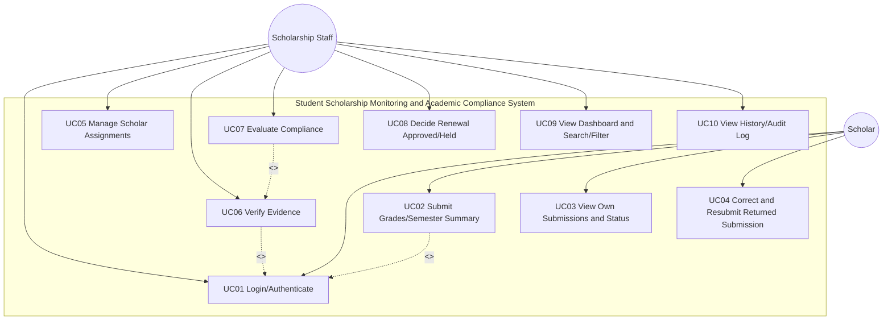

# PART I: ANALYSIS AND DESIGN 

**Project:** Student Scholarship Monitoring and Academic Compliance System  
**Course:** Systems Analysis and Design Laboratory Exam  
**Section:** B  
**Academic Year:** 2026-2027, Semester 1  
**Date:** 2026-10-21  

---

## A1 Investigation and Planning (6 pts)

### Problem Statement
The Scholarship Office administers Excellence Scholar and Access Scholar grants using spreadsheets, email attachments, and paper grade records. This causes duplicate semester entries, unverified grades, missed deadlines, and inconsistent renewal decisions. Scholars cannot see if a submission was received, verified, or returned. The solution is a browser-based MVP with two roles (Scholar, Scholarship Staff) where scholars submit semester academic summaries with a grade-document reference, staff verify evidence, evaluate policy compliance, record reasons, and decide renewal. The Registrar remains the source of official grades; the app does not alter official grades or release payments.

### 4 Problem-Cause-Effect Entries

| Problem | Cause | Effect |
| --- | --- | --- |
| P01 Duplicate semester entries | Manual tracking in spreadsheets with no uniqueness constraint | Conflicting records, incorrect renewal consideration |
| P02 Unverified grades/evidence | Evidence attached via email/paper with no verification workflow | Decisions made on unverified documents, risk of errors |
| P03 Missed deadlines | No centralized deadline tracking/visibility | Late submissions overlooked or handled inconsistently |
| P04 Inconsistent renewal decisions | No standardized policy checks/reasons/history | Unfair treatment, lack of auditability and transparency |

### Scope and Exclusions

**Scope:**
- Two roles: Scholar and Scholarship Staff
- Scholar submits semester academic summary with grade-document reference (academic year/semester, GWA, enrolled units, failed/incomplete/dropped counts, evidence reference)
- Staff verify evidence (Verified/Returned), evaluate policy compliance per program thresholds, record reasons, decide renewal (Approved/Held)
- Three statuses tracked separately: submission status (Pending/Verified/Returned), academic compliance (Compliant/With Deficiency), award status (Active)
- Dashboard with counts and search/filter by semester/program/compliance/student
- History/audit of verification/evaluation/renewal with actor/timestamp/notes
- Persistence with RLS enforcing role-based access (scholars see only own; staff see all)
- Policy thresholds read from persisted program records

**Exclusions:**
- Altering official Registrar grades
- Releasing payments/disbursements
- Managing appeals/exception workflows beyond recording reasons
- Multi-year tracking across different academic years beyond AY 2026-2027 Sem 1 scope
- Integration with Registrar systems/APIs
- Complex reporting/analytics beyond required dashboard counts and search/filter

### 4 Development Tasks

| Task ID | Task | Priority | Deliverable |
| --- | --- | --- | --- |
| DT01 | Schema, migrations, RLS policies | High | DB schema with constraints (unique scholar+AY+semester), RLS rules |
| DT02 | Scholar submission + validation | High | Form with validation (GWA 1.00-5.00, non-negative ints), duplicate prevention, deadline awareness |
| DT03 | Verification, compliance evaluation, renewal decisions | High | Workflow enforcing Verified-only evaluation, policy checks from program record, reasons/history |
| DT04 | Dashboard, search/filter, tests, seed | High | Dashboard counts, search/filter, TC01-TC10 results, seed data |

### 2 Risks with Responses

| Risk | Impact | Likelihood | Response/Mitigation |
| --- | --- | --- | --- |
| R01 RLS misconfiguration allowing cross-role/data leakage | High | Med | Test with TC08 (scholar cannot read others/perform staff actions); enforce in backend/DB, not UI-only; validate policies before UI |
| R02 Policy thresholds hardcoded in code | High | Med | Read thresholds from scholarship_programs table per assignment; no duplication in evaluation logic; verify against seed programs |


## A2 Stakeholders and Elicitation (4 pts)

### 4 Stakeholders (distinguish actors)

| Stakeholder | Role/Interest | Type | System Actor? | Notes |
| --- | --- | --- | --- | --- |
| S01 Scholar (recipient) | Wants transparency on submission status and renewal | End user | Yes - Scholar role | Submits summaries; views own submissions/history/statuses |
| S02 Scholarship Staff (Office) | Administers grants, verifies, evaluates, decides renewal | End user/admin | Yes - Staff role | Verifies evidence, evaluates compliance, approves/holds, manages assignments |
| S03 Registrar | Source of official grades | External authority | No (not a system actor) | App must not alter official grades; evidence references may point to Registrar records |
| S04 Scholarship Office Head/Policy Owner | Defines policy thresholds/rules | Policy stakeholder | No (not a direct actor in MVP) | Rules given as policy table; implemented via persisted program records |

### 6 Open-ended Elicitation Questions

| QID | Question | Purpose (covers) |
| --- | --- | --- |
| EQ01 | "How do you currently verify grade evidence before making renewal decisions, and what makes verification difficult?" | Verification |
| EQ02 | "What are your hard deadlines for grade submissions each semester, and how are late submissions handled?" | Deadlines |
| EQ03 | "Under what circumstances might policy exceptions be considered, and who has authority to approve them?" | Policy exceptions |
| EQ04 | "What access should scholars have to see the status of their submissions (received/verified/returned), and what must remain private?" | Access |
| EQ05 | "What reports/summary views does the office need at a glance (pending, compliant, deficiencies) to manage workload?" | Reports |
| EQ06 | "How do you want to track changes to verification/evaluation/renewal decisions over time for audit purposes?" | Audit/history & accountability |


## A3 Requirements and Rules (10 pts)

### 10 Testable Functional Requirements

| FR ID | Requirement | Actor | Priority | Testable Condition |
| --- | --- | --- | --- | --- |
| FR01 | Role-based access control | Scholar, Staff | High | Scholar cannot access others' records; staff can access all; enforced by RLS |
| FR02 | Scholar assignment to program | Staff | High | Staff assigns scholar to Excellence or Access with persisted policy record |
| FR03 | Grade submission with validation | Scholar | High | Submit AY/Sem, academic summary, evidence ref; validate GWA 1.00-5.00, non-negative ints; timestamp recorded |
| FR04 | Duplicate semester prevention | Scholar/System | High | Reject duplicate (scholar_id, academic_year, semester) with clear message |
| FR05 | Evidence verification workflow | Staff | High | Mark Verified or Returned with reason; Returned allows correction/resubmission back to Pending |
| FR06 | Policy-driven compliance evaluation | Staff | High | Evaluate only Verified submissions using thresholds from program record; produce Compliant/With Deficiency with reasons |
| FR07 | Renewal decision authority | Staff | High | Record Approved or Held; cannot approve if With Deficiency; reasons/notes stored |
| FR08 | Status separation | System | High | Maintain submission_status, academic_compliance, award_status independently (Verified + With Deficiency possible, award stays Active) |
| FR09 | Dashboard and search/filter | Staff/Scholar | High | Dashboard counts by selected semester; search by student ID/name; filter by program/compliance |
| FR10 | Audit history | System | High | Log verification, evaluation, renewal with actor, timestamp, notes | 

### 4 Measurable Non-Functional Requirements

| NFR ID | Requirement | Metric/Target | Verification |
| --- | --- | --- | --- |
| NFR01 | Security (RLS) | 100% of cross-role access attempts denied by DB | TC08 |
| NFR02 | Data integrity | Uniqueness enforced on (scholar_id, academic_year, semester); FK constraints present | Schema check + duplicate test TC07 |
| NFR03 | Performance (MVP) | Dashboard loads with seeded data (< 2s in local/browser) | Manual observation |
| NFR04 | Portability | Runs locally if hosting fails; uses only HTML/CSS/JS + Supabase | README run steps for local/hosted | 

### 6 Business Rules

| BR ID | Business Rule | Enforcement |
| --- | --- | --- |
| BR01 | Role access: scholars see ONLY their own submissions; staff view/verify all | RLS policies + UI respects roles |
| BR02 | Three separate statuses: submission (Pending/Verified/Returned), compliance (Compliant/With Deficiency), award (Active). A Verified submission can be With Deficiency while award stays Active. No auto-disqualification. | Schema fields separate; evaluation logic does not change award_status automatically |
| BR03 | Policy selection: each scholar assignment uses a persisted scholarship program record; thresholds read from program record, never duplicated in evaluation code | FK to scholarship_programs; evaluation reads from joined record |
| BR04 | Duplicate prevention: submissions unique per scholar + academic year + semester | DB unique constraint + validation message |
| BR05 | Verification required: evaluate ONLY verified submissions. Missing/unverified evidence prevents final evaluation | Workflow checks submission_status == 'Verified' before evaluation |
| BR06 | Renewal authority: staff explicitly record Approved/Held. Approval requires Compliant evaluation. Staff may hold but cannot approve deficient record. | Validation in evaluation/renewal actions + stored decision |


## A4 UML Use Case Model (8 pts)

### Use Case Diagram (Mermaid)



### Justification of Relationships

**1. UC02 (Submit Grades) <<include>> UC01 (Authenticate)**
- **Arrow:** from including (UC02) to included (UC01) as per notation
- **Type:** Mandatory reused behavior. A scholar cannot submit without being authenticated; authentication is required for every submission action. (Authentication is treated as a precondition in detailed UC, but as mandatory cross-cutting behavior it is included here.)

**2. UC06 (Verify Evidence) <<include>> UC01 (Authenticate)**
- **Arrow:** from including (UC06) to included (UC01)
- **Type:** Mandatory reused behavior. Only authenticated staff can verify evidence; this is required regardless of verification outcome.

**3. UC07 (Evaluate Compliance) <<extend>> UC06 (Verify Evidence)**
- **Arrow:** from extending (UC07) to base (UC06) as per notation (extend goes from extending use case to base)
- **Type:** Conditional behavior at a defined extension point. Evaluation only occurs after evidence is verified (extension point "after verification" in UC06). It is not mandatory for verification itself - staff may verify and not immediately evaluate, or evaluation is triggered as a separate action after verification. The condition is "submission status becomes Verified". This matches <<extend>> semantics (conditional, not mandatory). 

**Notes:** Authentication could be modeled as precondition only; here it is shown as included where mandatory per action. No extra relationships added just to meet counts.


## A5 Detailed Use Cases and Data Design (8 pts)

### Detailed Use Case 1: Submit Grades

**Use Case ID:** UC02  
**Name:** Submit Grades  
**Actor:** Scholar  
**Trigger:** Scholar initiates semester grade submission for current/target AY-Sem  
**Priority:** High  
**Linked FR/BR:** FR03, FR04, BR01, BR04  

#### Preconditions
- Scholar is authenticated (UC01)
- Scholar has an active assignment to a scholarship program (Excellence or Access)
- No existing submission for (scholar_id, academic_year, semester) exists (or will be validated)

#### Main Flow (Numbered)
1. Scholar navigates to submission form
2. System displays form with AY, Semester, academic summary fields, evidence reference
3. Scholar selects academic year and semester
4. Scholar enters GWA, enrolled units, failed count, incomplete count, dropped count
5. Scholar enters grade-document reference (evidence reference)
6. Scholar submits form
7. System validates inputs (GWA 1.00-5.00 inclusive, counts/units non-negative integers)
8. System checks for duplicate (scholar_id, academic_year, semester) - rejects if exists
9. System records submission with submission_status='Pending', academic_compliance not evaluated, award_status remains as assigned (Active), timestamp, evidence reference
10. System confirms submission received and displays status 'Pending verification'

#### Alternative Flows
**A1: Returned submission correction** - If submission was previously Returned, Scholar may correct and resubmit (see UC04); system returns to Pending.

#### Exception Flows
**E1: Invalid input** - If validation fails (e.g., GWA out of range, negative counts), system displays specific error message and does not create submission.
**E2: Duplicate submission** - If duplicate exists, system rejects with clear message "Duplicate semester submission exists for this AY/Semester".
**E3: Missing evidence reference** - If evidence reference empty, system rejects with message requiring grade-document reference.

#### Postconditions
- Submission record created with unique (scholar_id, academic_year, semester)
- submission_status = 'Pending'
- Timestamp recorded
- Scholar can view submission in "My Submissions" with status visible

### Detailed Use Case 2: Evaluate Compliance

**Use Case ID:** UC07  
**Name:** Evaluate Compliance  
**Actor:** Scholarship Staff  
**Trigger:** Staff chooses to evaluate a submission that is Verified  
**Priority:** High  
**Linked FR/BR:** FR06, FR07, BR02, BR05, BR06  

#### Preconditions
- Staff is authenticated (UC01)
- Submission exists and belongs to some scholar
- submission_status == 'Verified' (evidence verified). Missing/unverified evidence prevents evaluation.
- Policy thresholds available from scholar's assigned scholarship_program record

#### Main Flow (Numbered)
1. Staff views verified submission details (academic summary, evidence, scholar assignment/program)
2. Staff initiates evaluation
3. System loads policy thresholds from scholarship_programs for the assigned program
4. System performs policy checks against thresholds:
   - Max GWA (Excellence 2.00, Access 2.50) - smaller GWA better; violation if GWA > max
   - Min enrolled units (Excellence 18, Access 15)
   - Allowed failed (0 for both)
   - Allowed incomplete (0 for both)
   - Allowed dropped (Excellence 0, Access 1)
   - Deadline check (submitted on/before 2026-11-06 17:00 Asia/Manila? Policy states "Deadline: 2026-11-06 17:00 Asia/Manila (both). Exact deadline = on time; after = late." - evaluation considers lateness if relevant; missing/unverified evidence prevents final evaluation - after verification, late submission = With Deficiency with specific reason per policy)
5. System determines academic_compliance: Compliant if ALL checks pass; else With Deficiency with specific reasons for each failed check
6. System records compliance result, reasons, evaluator (staff), timestamp
7. Staff reviews compliance result and deficiency reasons
8. Staff explicitly records renewal decision: Approved or Held (BR06). Approval requires academic_compliance == 'Compliant'; if With Deficiency, cannot approve - must Hold with notes
9. System records renewal decision, decision notes, actor, timestamp; updates history/audit log
10. System displays final decision; award_status remains Active (no auto-disqualification per BR02)

#### Alternative Flows
**A1: Hold decision** - Staff may hold renewal even if compliant (discretionary) but must provide notes? Policy states "Staff may hold renewal but cannot approve a deficient record." - holding is allowed; approval requires compliant.

#### Exception Flows
**E1: Not verified** - If submission_status != 'Verified', system blocks evaluation with message "Missing or unverified evidence prevents final evaluation."
**E2: Attempt to approve deficient** - If academic_compliance == 'With Deficiency', system prevents approval and requires Hold with reason/notes.
**E3: Missing program thresholds** - If no program record/thresholds found, system blocks evaluation with error (should not happen if assignment exists).

#### Postconditions
- academic_compliance set to Compliant or With Deficiency with specific reasons
- renewal decision recorded as Approved or Held with actor/timestamp/notes
- History/audit entry created for evaluation and renewal
- award_status unchanged (remains Active) per BR02


### ERD (Entities, PKs, FKs, Cardinalities)

```mermaid
erDiagram
  USER_PROFILES {
    uuid id PK
    uuid auth_user_id UK
    string role "scholar|staff"
    string student_id UK
    string full_name
    string email
    timestamp created_at
    timestamp updated_at
  }
  
  SCHOLARSHIP_PROGRAMS {
    uuid id PK
    string code UK "EXCELLENCE|ACCESS"
    string name
    decimal max_gwa
    int min_enrolled_units
    int allowed_failed
    int allowed_incomplete
    int allowed_dropped
    string evidence_required
    timestamp deadline_at "Asia/Manila context"
    timestamp created_at
  }
  
  SCHOLAR_ASSIGNMENTS {
    uuid id PK
    uuid scholar_id FK
    uuid program_id FK
    string academic_year
    int semester
    string award_status "Active"
    timestamp assigned_at
    uuid assigned_by FK "staff user"
  }
  
  SEMESTER_SUBMISSIONS {
    uuid id PK
    uuid scholar_id FK
    uuid assignment_id FK
    string academic_year
    int semester
    decimal gwa
    int enrolled_units
    int failed_count
    int incomplete_count
    int dropped_count
    string evidence_reference
    timestamp submitted_at
    string submission_status "Pending|Verified|Returned"
    uuid verified_by FK
    timestamp verified_at
    string verification_reason
    string academic_compliance "Compliant|With Deficiency|UnEvaluated"
    jsonb compliance_reasons
    timestamp evaluated_at
    uuid evaluated_by FK
    string renewal_decision "Pending|Approved|Held"
    string decision_notes
    timestamp decided_at
    uuid decided_by FK
  }
  
  EVALUATION_HISTORY {
    uuid id PK
    uuid submission_id FK
    string action "verification|evaluation|renewal"
    string actor_role
    uuid actor_id FK
    string from_status
    string to_status
    jsonb details
    string notes
    timestamp acted_at
  }
  
  USER_PROFILES ||--o{ SCHOLAR_ASSIGNMENTS : "scholar"
  USER_PROFILES ||--o{ SEMESTER_SUBMISSIONS : "scholar"
  SCHOLARSHIP_PROGRAMS ||--o{ SCHOLAR_ASSIGNMENTS : "program"
  SCHOLAR_ASSIGNMENTS ||--o{ SEMESTER_SUBMISSIONS : "assignment"
  SEMESTER_SUBMISSIONS ||--o{ EVALUATION_HISTORY : "submission"
  USER_PROFILES ||--o{ SEMESTER_SUBMISSIONS : "verified_by/evaluated_by/decided_by"
  USER_PROFILES ||--o{ EVALUATION_HISTORY : "actor"
}
```

**Notes on constraints:**
- Unique constraint on (scholar_id, academic_year, semester) for SEMESTER_SUBMISSIONS (prevents duplicates per BR04)
- FK relationships as shown with cardinalities (1:N as indicated)
- Statuses stored as specified: submission_status, academic_compliance, renewal_decision; award_status on assignment


## A6 Traceability (4 pts)

### Traceability Matrix (4 FRs)

| FR ID | Actor | Use Case | Business Rule | Implemented Screen/Function | Test ID | Expected Result |
| --- | --- | --- | --- | --- | --- | --- |
| FR01 | Scholar, Staff | UC01, UC02, UC06 | BR01 | Auth + RLS policies; role-based routing/views | TC08 | Scholar cannot read others' record or perform verification; backend denies |
| FR03/FR04 | Scholar | UC02 | BR04 | Submission form with validation + duplicate check | TC07 | Reject duplicate semester submission, GWA 0.50, and negative counts with clear messages |
| FR06 | Staff | UC07 | BR05, BR02 | Compliance evaluation using program thresholds (read from DB) | TC01, TC02, TC03, TC04, TC05 | B01 Compliant; B02 With Deficiency (GWA); B03 Compliant (1 drop allowed Access); B04 With Deficiency (units+INC); B05 With Deficiency (failed+late) |
| FR07 | Staff | UC07/UC08 | BR06, BR02 | Renewal decision UI with approval guard | TC06, TC10 | TC06 blocks evaluation/approval until verified/evaluated; TC10 approve compliant, hold deficient; scholar cannot change decision |

### Planned Requirements Not Implemented (if any)
- None planned outside scope. All listed FRs/NFRs/BRs are in scope for MVP. Exception workflows beyond recording reasons are explicitly out of scope as per scenario.
